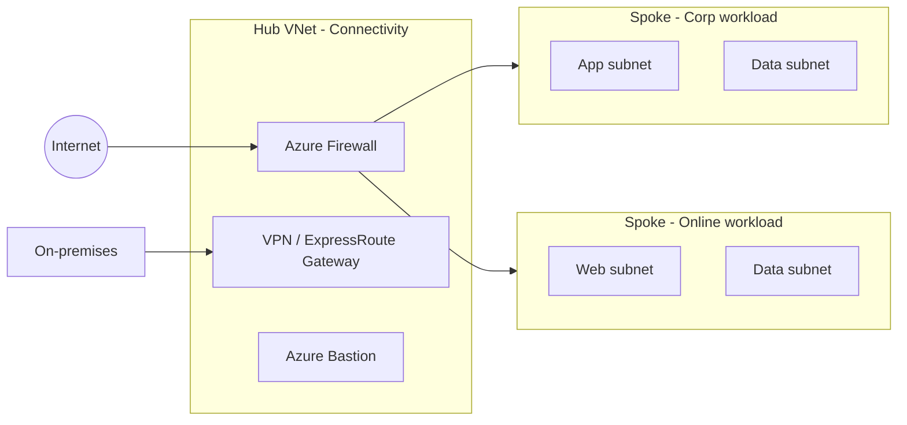
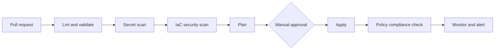

# Azure Landing Zone: DevSecOps Reference Design

A design for a secure, policy-governed Azure landing zone that is deployed through a security-gated CI/CD pipeline. Nothing reaches Azure without passing automated scanning, a reviewed plan, and an approval step.


---

## Why this exists

Most "landing zone" examples either stop at a diagram or dump a few hundred resources with no thought for how changes get reviewed. I wanted to document an approach where **governance and security are part of the delivery pipeline itself**, not something checked after deployment.

This repository holds the architecture, the design decisions behind it, and the delivery plan. Implementation is tracked in the [roadmap](#roadmap).

## Current status

| Area | State |
|---|---|
| Architecture and design decisions | Documented (this README) |
| Management group and subscription model | Defined |
| Pipeline design | Defined |
| Terraform modules | Planned |
| Pipeline workflows | Planned |
| Policy-as-code definitions | Planned |

I am keeping the status explicit on purpose. Everything below describes the intended design unless marked otherwise.

---

## Design goals

- **Secure by default.** Guardrails are enforced by Azure Policy, not by convention.
- **Everything as code.** No portal changes. The repository is the source of truth.
- **Shift security left.** Misconfigurations and leaked secrets should fail a pull request, not an audit.
- **Least privilege.** Pipelines authenticate with short-lived federated credentials, with no stored client secrets.
- **Repeatable.** A new workload subscription should be a small, reviewable change.

---

## Architecture

### Management group hierarchy

```
Tenant Root Group
└── Organization
    ├── Platform
    │   ├── Identity
    │   ├── Management
    │   └── Connectivity
    ├── Landing Zones
    │   ├── Corp          (private workloads, no public ingress)
    │   └── Online        (internet-facing workloads)
    ├── Sandbox           (isolated, budget-capped experimentation)
    └── Decommissioned
```

Policies are assigned at the management group level and inherited downward. Platform subscriptions are separated from workload subscriptions so that a compromised workload cannot reach shared services.

### Network topology

Hub-and-spoke, with the hub in the Connectivity subscription.



All spoke egress is routed through the firewall using user-defined routes. Spokes do not peer directly with each other.

### Delivery pipeline



| Stage | Purpose | Planned tooling |
|---|---|---|
| Lint and validate | Catch syntax and style problems early | `terraform fmt`, `terraform validate`, TFLint |
| Secret scan | Block committed credentials | Gitleaks |
| IaC security scan | Detect insecure resource configuration | Checkov, Trivy |
| Plan | Show exactly what will change, attached to the PR | `terraform plan` |
| Approval | Human gate before production changes | GitHub Environments with required reviewers |
| Apply | Deploy using federated identity | GitHub Actions with OIDC |
| Compliance check | Confirm deployed state matches policy | Azure Policy compliance API |

---

## Security and governance

**Identity and access**
- Entra ID groups mapped to Azure RBAC roles, never individual assignments
- Privileged roles gated by Privileged Identity Management (just-in-time access)
- Pipeline identity uses OIDC federation, so there is no long-lived secret to leak or rotate

**Policy**
- Deny: public IPs on non-approved resources, unencrypted storage, disallowed regions
- Audit: missing tags, missing diagnostic settings
- DeployIfNotExists: diagnostic settings to a central Log Analytics workspace, Defender plans

**Protection and monitoring**
- Microsoft Defender for Cloud enabled at subscription scope
- Centralized Log Analytics workspace in the Management subscription
- Key Vault for secrets, accessed via managed identity
- Terraform state in a private storage account with versioning and restricted access

---

## Key design decisions

| Decision | Choice | Reasoning |
|---|---|---|
| IaC language | Terraform | Large module ecosystem, mature scanning support, multi-cloud skills transfer |
| Pipeline auth | OIDC workload identity federation | Removes stored secrets from the pipeline |
| Network model | Hub-and-spoke | Central inspection and simpler egress control than a flat mesh |
| Policy delivery | Policy-as-code in the same repo | Policy changes get the same review and scanning as infrastructure |
| Environments | Separate state and approval per environment | Limits blast radius of a bad change |

---

## Planned repository structure

```
.
├── docs/                    Architecture notes and decision records
├── modules/
│   ├── management-groups/
│   ├── networking-hub/
│   ├── networking-spoke/
│   ├── policy/
│   └── monitoring/
├── environments/
│   ├── platform/
│   └── landing-zones/
├── policies/                Custom policy and initiative definitions
└── .github/workflows/       CI/CD pipelines
```

---

## Roadmap

- [x] Define management group and subscription model
- [x] Define network topology
- [x] Define pipeline stages and security gates
- [ ] Bootstrap: remote state backend and OIDC identity
- [ ] Management group and policy modules
- [ ] Hub network module
- [ ] Spoke network module with subscription vending
- [ ] GitHub Actions workflows with scanning and approval gates
- [ ] Defender for Cloud and logging baseline
- [ ] Cost and budget guardrails
- [ ] Documented threat model

---

## References

- [Azure Landing Zones, Cloud Adoption Framework](https://learn.microsoft.com/azure/cloud-adoption-framework/ready/landing-zone/)
- [DevSecOps for infrastructure as code, Azure Architecture Center](https://learn.microsoft.com/azure/architecture/solution-ideas/articles/devsecops-infrastructure-as-code)
- [Platform automation and DevOps design area](https://learn.microsoft.com/azure/cloud-adoption-framework/ready/landing-zone/design-area/platform-automation-devops)
- [Authenticate to Azure from GitHub Actions with OIDC](https://learn.microsoft.com/azure/developer/github/connect-from-azure-openid-connect)

---

## Author

**Aniket**, DevOps and cloud security
GitHub: [@aniket-devop](https://github.com/aniket-devop)

Feedback and suggestions are welcome through issues.
