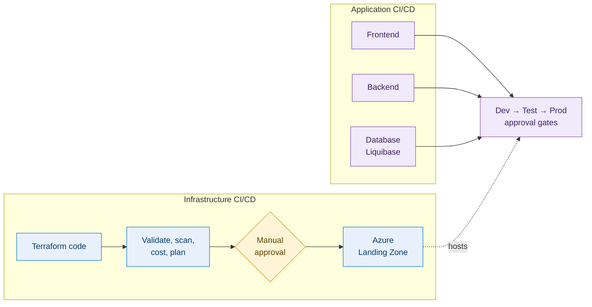
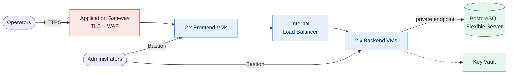
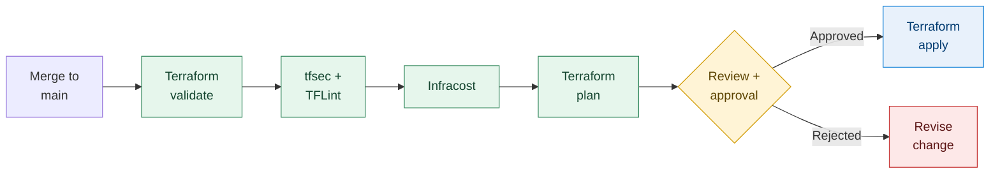
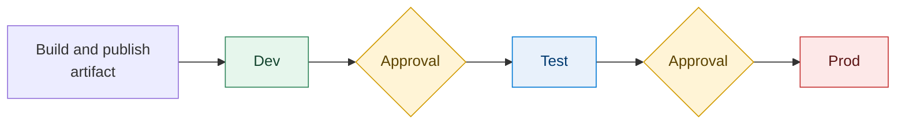
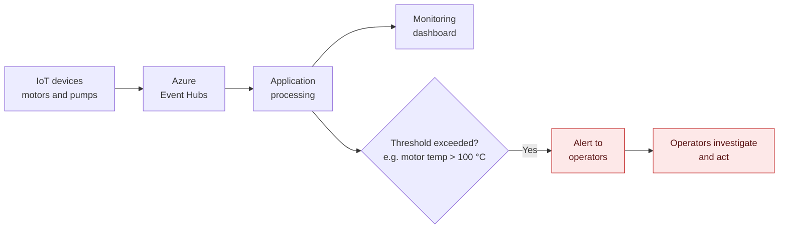

<div align="center">

# ☁️ Azure Landing Zone & DevSecOps

### Secure, automated cloud platform for an Industrial IoT monitoring system in petroleum refineries

**Everything as code. Every release scanned, costed, reviewed and approved.**


[🏗️ Architecture](#️-3-architecture-diagram) · [🔀 Traffic flow](#-4-high-level-architecture-and-traffic-flow) · [🚦 Pipelines](#️-8-infrastructure-cicd-pipeline) · [🧑‍🔧 My role](#-14-my-devsecops-role-and-responsibilities)

</div>

> [!NOTE]
> The application code was written by the wider development team. This repository documents the **platform and delivery pipelines**, which is the DevSecOps work I owned. See [section 14](#-14-my-devsecops-role-and-responsibilities) for my exact contribution.

---

## ⚡ TL;DR

| | |
|---|---|
| **What** | A three-tier Azure platform that collects IoT data from refinery motors and pumps, shows it on dashboards and raises alerts on abnormal readings |
| **How** | Azure Landing Zone built with modular **Terraform**, delivered through **Azure DevOps** pipelines |
| **Why it's interesting** | Security, quality and cost checks run *before* anything is applied, and nothing reaches Prod without human approval |
| **My role** | DevSecOps Engineer: designed the Landing Zone, Terraform structure and all pipelines |

---

## 🌟 Key Highlights

| Area | Summary |
|---|---|
| 🏗️ **Infrastructure as Code** | Azure Landing Zone built with reusable Terraform child modules plus per-environment configuration |
| 🔒 **Security built in** | WAF and TLS at the edge, subnet segmentation, private endpoints for PostgreSQL, Key Vault for secrets, Bastion for admin access |
| ⬅️ **Shift-left checks** | `terraform validate`, tfsec, TFLint and Infracost run before any infrastructure change is applied |
| ✅ **Controlled releases** | Plan review with manual approval, plus approval gates between Dev, Test and Prod |
| 🔀 **Independent pipelines** | Infrastructure CI/CD is separate from application CI/CD; the app has separate frontend, backend and database pipelines |
| 🗄️ **Versioned schema changes** | Database changes ship through Liquibase in a dedicated pipeline |

<div align="center">

| 3 | 3 | 4 | 4 | 2 |
|:---:|:---:|:---:|:---:|:---:|
| **environments**<br>Dev, Test, Prod | **app pipelines**<br>frontend, backend, database | **subnets**<br>frontend, backend, database, Bastion | **IaC checks**<br>validate, tfsec, TFLint, Infracost | **approval points**<br>before apply, between environments |

</div>

---

## 📑 Table of Contents

1. [Project Overview](#-1-project-overview)
2. [Business Problem and Solution](#-2-business-problem-and-solution)
3. [Architecture Diagram](#️-3-architecture-diagram)
4. [High-Level Architecture and Traffic Flow](#-4-high-level-architecture-and-traffic-flow)
5. [Azure Landing Zone and Network Design](#-5-azure-landing-zone-and-network-design)
6. [Security and Access Management](#️-6-security-and-access-management)
7. [Terraform Repository Structure](#-7-terraform-repository-structure)
8. [Infrastructure CI/CD Pipeline](#️-8-infrastructure-cicd-pipeline)
9. [Terraform Security, Validation and Cost Estimation](#-9-terraform-security-validation-and-cost-estimation)
10. [Application CI/CD Pipeline](#-10-application-cicd-pipeline)
11. [Dev, Test and Prod Promotion Strategy](#-11-dev-test-and-prod-promotion-strategy)
12. [Database Migration with Liquibase](#️-12-database-migration-with-liquibase)
13. [Monitoring and Alerting](#-13-monitoring-and-alerting)
14. [My DevSecOps Role and Responsibilities](#-14-my-devsecops-role-and-responsibilities)
15. [Technology Stack](#-15-technology-stack)
16. [Setup and Deployment Guide](#️-16-setup-and-deployment-guide)
17. [Validation and Troubleshooting](#-17-validation-and-troubleshooting)
18. [Cleanup and Cost Considerations](#-18-cleanup-and-cost-considerations)

---

## 🚀 1. Project Overview

This project is an Azure-hosted, three-tier **industrial IoT monitoring and alerting application** for a customer that runs several petroleum refineries.

IoT devices on motors and pumps send operational metrics to **Azure Event Hubs**. The application processes that data, shows it on monitoring dashboards, and raises an alert when a reading goes past its threshold.

My part was the platform and the delivery around it:

- **Platform:** designing the Azure Landing Zone and provisioning it with Terraform.
- **Delivery:** building Azure DevOps pipelines that ship infrastructure and application through Dev, Test and Prod, with automated security, quality and cost checks and manual approvals.

Infrastructure and application releases run in **separate pipelines**, so an application release never waits on an infrastructure change, and the other way round.



---

## 🎯 2. Business Problem and Solution

### The problem

Motors and pumps are critical equipment in a refinery. A temperature that keeps climbing, for example, can point to a fault that is still developing. Operators need to see the condition of equipment across several sites, and they need to be told quickly when something looks wrong.

### The solution

| Need | How the platform handles it |
|---|---|
| Collect equipment metrics | IoT devices send data to Azure Event Hubs |
| See equipment condition | The application processes the data and shows it on monitoring dashboards |
| Act on abnormal readings | Alerts go to operators when a metric crosses a threshold, such as motor temperature above **100 °C** |
| Run it safely | A segmented Azure network with layered controls, deployed through repeatable, reviewed and approved pipelines |

---

## 🗺️ 3. Architecture Diagram

<div align="center">


*Three-tier Azure architecture: Application Gateway (WAF) → frontend VMs → Internal Load Balancer → backend VMs → PostgreSQL via private endpoints*

</div>

---

## 🔀 4. High-Level Architecture and Traffic Flow

The platform is a classic three-tier design: presentation, application and data. Each tier sits in its own subnets of one Azure Virtual Network.



### Request flow

1. Users, such as refinery operators, reach the application through **Azure Application Gateway**. It terminates SSL/TLS and inspects traffic with the **Web Application Firewall (WAF)**.
2. Application Gateway passes allowed requests to the two frontend VMs.
3. The frontend calls the backend through an **Internal Load Balancer**, which spreads the load over the two backend VMs.
4. The backend talks to **Azure Database for PostgreSQL Flexible Server** over private endpoints, so database traffic never leaves the private network.
5. Secrets are kept in **Azure Key Vault**.

### Data ingestion flow

IoT devices on motors and pumps publish metrics to **Azure Event Hubs**. The application processes them, updates the dashboard and checks alert thresholds.

### Administrative access

Administrators connect to the VMs through **Azure Bastion**. No management ports are open to the internet.

---

## 🧱 5. Azure Landing Zone and Network Design

The whole Landing Zone is provisioned with Terraform. The network is split into dedicated subnets, so each tier has one job and limited exposure.

| Subnet | Purpose | Components |
|---|---|---|
| **Frontend** | Public entry point, presentation tier | Application Gateway (TLS, WAF), two frontend VMs |
| **Backend** | Application tier, not reachable from the internet | Internal Load Balancer, two backend VMs |
| **Database** | Data tier | PostgreSQL Flexible Server via private endpoints |
| **Bastion** | Administrative access | Azure Bastion |

### Network boundaries

| Boundary | Behaviour |
|---|---|
| 🌐 Internet → platform | Traffic enters only through Application Gateway, where TLS ends and the WAF inspects requests |
| ↔️ Frontend → backend | Goes through an Internal Load Balancer, so the backend is only reachable from inside the virtual network |
| 🗄️ Backend → database | Uses private endpoints, keeping PostgreSQL traffic on the private network |
| 🛠️ Admin → VMs | Goes through Azure Bastion in its own subnet |

---

## 🛡️ 6. Security and Access Management

Security is layered: at the network edge, inside the network, at the data tier, and in the delivery pipeline.

| Layer | Control | Purpose |
|---|---|---|
| Edge | Application Gateway with WAF | Ends TLS and inspects inbound web traffic |
| Network | Subnet segmentation | Separate frontend, backend, database and Bastion subnets |
| Network | Internal Load Balancer | Keeps backend traffic inside the virtual network |
| Data | Private endpoints for PostgreSQL | Keeps database connectivity private |
| Access | Azure Bastion | VM administration without public management ports |
| Secrets | Azure Key Vault | Keeps secrets out of code and pipeline definitions |
| Pipeline | tfsec and TFLint | Catch misconfigurations and quality problems before deployment |
| Pipeline | SonarQube | Code-quality checks on application code |
| Process | Manual approval gates | A person signs off before apply and before each promotion |

---

## 📦 7. Terraform Repository Structure

The Terraform code is modular. Reusable **child modules** define each component (networking, compute, database, security), and **environment-specific configuration** provides the values for Dev, Test and Prod. That keeps the environments consistent and avoids copy-pasted code.

Branching is **trunk-based**, with `main` as the trunk.

```text
.
├── modules/          Reusable child modules
├── environments/     Environment-specific configuration
│   ├── dev/
│   ├── test/
│   └── prod/
└── pipelines/        Azure DevOps pipeline definitions
```

---

## 🏗️ 8. Infrastructure CI/CD Pipeline

Infrastructure is delivered by Azure DevOps pipelines that are separate from the application pipelines. A change merged to `main` is validated, scanned, costed and planned. It is applied **only after someone reviews the plan and approves it**.



| Stage | What happens |
|---|---|
| ✔️ Validate | The Terraform configuration is validated |
| 🔍 Scan | tfsec and TFLint analyse the code |
| 💰 Cost estimate | Infracost estimates the cost of the change |
| 📋 Plan | Terraform produces an execution plan |
| 👀 Review and approve | The plan is reviewed and explicitly approved |
| 🚀 Apply | Terraform applies the approved plan |

---

## 🔐 9. Terraform Security, Validation and Cost Estimation

| Tool / step | Role in the pipeline |
|---|---|
| **Terraform validate** | Confirms the configuration is syntactically valid and consistent |
| **tfsec** | Static security analysis that flags likely misconfigurations |
| **TFLint** | Linting for code quality, best practice and likely errors |
| **Infracost** | Shows the cost impact of a change while it is being reviewed |
| **Plan review** | Engineers see exactly what will be created, changed or destroyed |
| **Manual approval** | The gate between plan and apply, so nothing is applied without sign-off |

> [!TIP]
> All of these run **before** apply. Security, quality and cost problems show up at the earliest point, when they are cheapest to fix.

---

## 🧑‍💻 10. Application CI/CD Pipeline

Frontend, backend and database each have their own pipeline. Each one can be built, checked and released without touching the others, and without waiting for an infrastructure change.

| Pipeline | Scope |
|---|---|
| **Frontend** | Build, quality check and deployment to the frontend VMs |
| **Backend** | Build, quality check and deployment to the backend VMs |
| **Database** | Schema changes with Liquibase ([section 12](#️-12-database-migration-with-liquibase)) |

Shared by all three:

- **SonarQube** code-quality checks
- **Azure Pipeline Artifacts** for build output, so the artifact that was tested is the one that gets promoted
- Deployment through Dev, Test and Prod with manual approval gates ([section 11](#-11-dev-test-and-prod-promotion-strategy))

### Infrastructure vs. application CI/CD

| | Infrastructure CI/CD | Application CI/CD |
|---|---|---|
| **Delivers** | Azure resources (Landing Zone) via Terraform | Frontend, backend and database changes |
| **Checks** | Validate, tfsec, TFLint, Infracost, plan review | SonarQube |
| **Output** | Applied infrastructure | Pipeline Artifacts deployed to environments |
| **Gate** | Manual approval before apply | Manual approval before each promotion |

---

## 🚦 11. Dev, Test and Prod Promotion Strategy

Infrastructure and applications both move through three environments.



- **Build once, promote the same artifact.** It is not rebuilt for each environment.
- **Manual approval gates** control movement between environments, so a release reaches Test and Prod only after sign-off.
- **Configuration, not code, differs** between environments.

---

## 🗄️ 12. Database Migration with Liquibase

Schema changes are handled by **Liquibase** and released through a dedicated database pipeline. The changes are version-controlled and reviewable, and they are applied in the same order in Dev, Test and Prod, behind the same approval gates as the other pipelines.

The target is **Azure Database for PostgreSQL Flexible Server**, reached through private endpoints.

---

## 📈 13. Monitoring and Alerting



1. IoT devices send metrics to Azure Event Hubs.
2. The application processes the incoming data.
3. Metrics show up on the monitoring dashboard.
4. When a metric passes its threshold, an alert goes to the refinery operators.
5. Operators investigate and take action.

---

## 🧑‍🔧 14. My DevSecOps Role and Responsibilities

I was the **DevSecOps engineer** on this project. The development team built the application; I was responsible for the Azure platform and the delivery pipelines around it.

| Area | What I delivered |
|---|---|
| ☁️ **Landing Zone** | Designed the Azure Landing Zone and provisioned it with Terraform |
| 📦 **Terraform design** | Structured the repository into reusable child modules and per-environment configuration |
| 🌿 **Branching** | Applied a trunk-based strategy on `main` |
| 🔧 **Pipelines** | Built Azure DevOps pipelines for Terraform and application CI/CD |
| 🔐 **IaC security and quality** | Integrated tfsec and TFLint |
| 💰 **Validation and cost** | Integrated Terraform validation and Infracost |
| ✅ **Controlled apply** | Set up the plan review, manual approval and apply stages |
| 🧩 **Application pipelines** | Created separate pipelines for frontend, backend and database |
| 📊 **Code quality** | Added SonarQube checks and used Azure Pipeline Artifacts |
| 🚦 **Promotion** | Set up deployments across Dev, Test and Prod with manual approval gates |
| 🗄️ **Schema changes** | Used Liquibase for database migrations |

### 💡 Skills demonstrated

`Azure Landing Zone design` · `Terraform modules` · `Azure DevOps YAML pipelines` · `DevSecOps / shift-left security` · `Network segmentation` · `Private endpoints` · `Secrets management` · `FinOps with Infracost` · `Release governance` · `Database migrations as code`

---

## 🧰 15. Technology Stack

| Area | Technology |
|---|---|
| ☁️ Cloud platform | Microsoft Azure |
| 🏗️ Infrastructure as Code | Terraform |
| 🔧 CI/CD | Azure DevOps Pipelines, Azure Pipeline Artifacts |
| 🔐 IaC security and quality | tfsec, TFLint, Terraform validate |
| 💰 Cost estimation | Infracost |
| 📊 Code quality | SonarQube |
| 🗄️ Database migrations | Liquibase |
| 🌐 Networking and edge | Virtual Network, Application Gateway (TLS, WAF), Internal Load Balancer |
| 💻 Compute | Azure Virtual Machines (frontend and backend tiers) |
| 🛢️ Data | Azure Database for PostgreSQL Flexible Server (private endpoints) |
| 🔑 Secrets and access | Azure Key Vault, Azure Bastion |
| 📡 Data ingestion | Azure Event Hubs |
| 🌿 Branching model | Trunk-based development (`main`) |

---

## 🛠️ 16. Setup and Deployment Guide

Deployments are meant to run through the Azure DevOps pipelines, not by hand.

### Prerequisites

- An Azure subscription with permission to deploy the Landing Zone
- An Azure DevOps organisation and project with pipeline permissions
- A service connection from Azure DevOps to Azure
- A remote Terraform state backend
- The tools the pipelines use: Terraform, tfsec, TFLint, Infracost, SonarQube, Liquibase

### Deployment order

1. **Infrastructure.** Merge to `main` and run the infrastructure pipeline. Check the validation, scan, cost and plan output, then approve to apply.
2. **Database.** Run the database pipeline to apply the Liquibase changes.
3. **Backend and frontend.** Run the backend and frontend pipelines to deploy the application artifacts.
4. **Promote.** Move the release through Dev, Test and Prod, approving at each gate.

---

## 🔎 17. Validation and Troubleshooting

<details>
<summary><b>✅ Post-release checklist</b></summary>

<br>

- [ ] The infrastructure pipeline passed validate, tfsec, TFLint and Infracost
- [ ] The Terraform plan was reviewed and approved before apply
- [ ] The application is reachable over HTTPS through Application Gateway
- [ ] Frontend VMs reach the backend through the Internal Load Balancer
- [ ] Backend VMs connect to PostgreSQL through the private endpoint
- [ ] Liquibase changes were applied in the target environment
- [ ] IoT data from Event Hubs appears on the dashboard
- [ ] A test threshold breach (for example, above 100 °C) triggers an alert

</details>

<details>
<summary><b>🩺 Troubleshooting guide</b></summary>

<br>

| Symptom | Where to look |
|---|---|
| Pipeline fails at a scan stage | tfsec and TFLint findings; fix the issue, or record why it is accepted |
| Cost estimate higher than expected | Infracost output and the resources in the plan |
| Application not reachable | Application Gateway listener and TLS config, WAF rules, backend health, network rules |
| Frontend cannot reach backend | Internal Load Balancer health, backend VM status, rules between subnets |
| Backend cannot reach database | Private endpoint status, name resolution, network rules |
| Cannot administer a VM | Bastion configuration and access permissions |
| No data on the dashboard | Device connectivity to Event Hubs, application event processing |
| Alerts not received | Threshold configuration and notification channel setup |

</details>

---

## 🧹 18. Cleanup and Cost Considerations

### Cost

Infracost runs in the infrastructure pipeline, so the cost of a change is visible **before** it is approved. The resources that carry ongoing cost are the VMs, Application Gateway, Azure Bastion, PostgreSQL Flexible Server and Event Hubs. For real numbers, check current Azure pricing and the Infracost output.

### Cleanup

1. Confirm that the environment and its data can be removed.
2. Remove the infrastructure through the Terraform pipeline or an approved destroy process.
3. Check in the Azure portal that the resources are gone.

> [!WARNING]
> Destroying Prod should always need explicit approval.

---

<div align="center">

### 👋 Let's connect

**Aniket Kumar** · DevSecOps Engineer

[](https://linkedin.com/in/aniket484)
[](https://github.com/aniket-devop)

⭐ If this project helped you, consider giving the repo a star.

</div>
