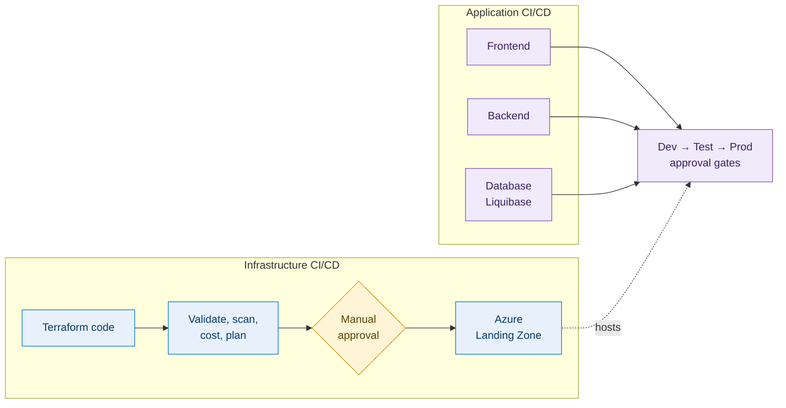
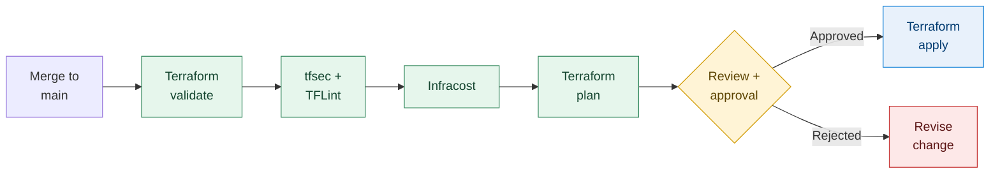
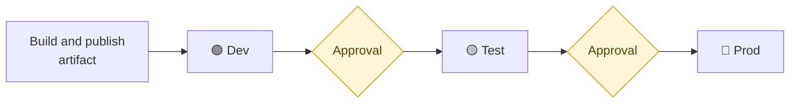
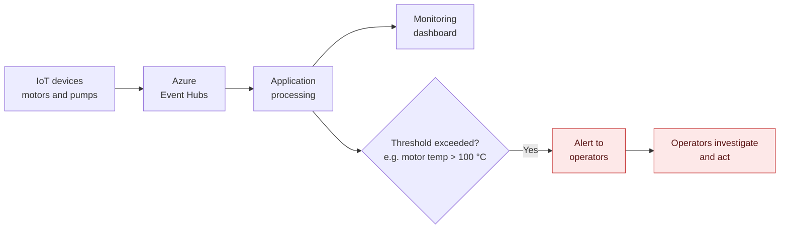

<div align="center">


**A three-tier Azure platform provisioned as code with Terraform and shipped through Azure DevOps pipelines,<br>with security, quality, cost and approval controls built into every release.**

[Architecture](#-architecture) · [Security](#-network-and-security) · [Pipelines](#-infrastructure-pipeline) · [Promotion](#-environment-promotion) · [My role](#-my-role)

</div>

> [!NOTE]
> The application code was written by the wider development team. This repository documents the Azure platform and the delivery pipelines around it, which were my responsibility as the DevSecOps engineer. See [My role](#-my-role).

---

## At a glance

<div align="center">

| 3 | 3 | 4 | 4 | 2 |
|:---:|:---:|:---:|:---:|:---:|
| **environments**<br>Dev, Test, Prod | **application pipelines**<br>frontend, backend, database | **network subnets**<br>frontend, backend, database, Bastion | **automated checks**<br>validate, tfsec, TFLint, Infracost | **approval gates**<br>before apply and before promotion |

</div>

## Key highlights

| | | |
|---|---|---|
| **🧱 Infrastructure as Code**<br>Azure Landing Zone built from modular Terraform: reusable child modules plus per-environment configuration. | **🛡️ Security built in**<br>WAF and TLS at the edge, subnet segmentation, private endpoints for PostgreSQL, Key Vault for secrets, Bastion for admin access. | **🔍 Shift-left checks**<br>tfsec, TFLint, Terraform validation and Infracost run before any infrastructure change is applied. |
| **✋ Controlled releases**<br>Plan review with manual approval, and approval gates between Dev, Test and Prod. | **🧩 Independent pipelines**<br>Infrastructure CI/CD is separate from application CI/CD, and the app has separate frontend, backend and database pipelines. | **🗄️ Versioned schema changes**<br>Database changes delivered with Liquibase through a dedicated pipeline. |

---

## 🚀 Overview

The customer operates multiple petroleum refineries, where motors and pumps are critical assets. A rising temperature or an unusual reading can be the first sign of a developing fault, so operators need timely visibility of equipment condition across sites and a fast notification when something goes wrong.

| Step | What happens |
|---|---|
| **1. Collect** | Industrial IoT devices on motors and pumps send metrics to **Azure Event Hubs** |
| **2. Show** | The application processes the data and presents it on monitoring dashboards |
| **3. Alert** | When a reading crosses a configured threshold (for example, motor temperature above **100 °C**), operators are notified |

The DevSecOps work covers two connected areas: the **platform** (the Azure Landing Zone, provisioned with Terraform) and the **delivery** (Azure DevOps pipelines that deploy infrastructure and application across Dev, Test and Prod, with automated checks and manual approval gates).

Infrastructure and application delivery are deliberately separate pipelines:



---

## 🗺️ Architecture

<div align="center">


</div>

The platform is a classic three-tier design (presentation, application, data), with each tier in its own subnet of an Azure Virtual Network.


**Request flow**

1. Users, such as refinery operators, reach the application through **Azure Application Gateway**, which terminates SSL/TLS and applies **Web Application Firewall (WAF)** inspection.
2. Application Gateway forwards permitted requests to the two frontend VMs.
3. The frontend calls the backend through an **Internal Load Balancer**, which spreads traffic across the two backend VMs.
4. The backend connects to **Azure Database for PostgreSQL Flexible Server** through private endpoints, so database traffic stays on the private network.
5. Secrets are held in **Azure Key Vault**.

**Data ingestion.** IoT devices publish metrics to Event Hubs. The application processes them, updates the dashboard and evaluates alert thresholds.

**Administrative access.** Administrators reach the VMs through **Azure Bastion**. Management ports are not exposed to the internet.

---

## 🛡️ Network and security

Each tier has its own subnet, so responsibilities are clear and exposure is limited.

| Subnet | Purpose | Components |
|---|---|---|
| 🟦 **Frontend** | Public entry point, presentation tier | Application Gateway (TLS, WAF), two frontend VMs |
| 🟩 **Backend** | Application tier, not reachable from the internet | Internal Load Balancer, two backend VMs |
| 🟧 **Database** | Data tier | PostgreSQL Flexible Server via private endpoints |
| 🟪 **Bastion** | Administrative access | Azure Bastion |

Security is applied in layers, from the network edge to the delivery pipeline.

| Layer | Control | Purpose |
|---|---|---|
| **Edge** | Application Gateway with WAF | Terminates TLS and inspects inbound web traffic |
| **Network** | Subnet segmentation | Separates frontend, backend, database and Bastion |
| **Network** | Internal Load Balancer | Keeps backend traffic inside the virtual network |
| **Data** | Private endpoints | Keeps database connectivity on the private network |
| **Access** | Azure Bastion | VM administration without public management ports |
| **Secrets** | Azure Key Vault | Keeps secrets out of code and pipeline definitions |
| **Pipeline** | tfsec, TFLint | Catch misconfigurations and quality issues before deployment |
| **Pipeline** | SonarQube | Code-quality checks on application code |
| **Process** | Manual approval gates | Human review before apply and before each promotion |

---

## 📦 Infrastructure as code

The Terraform code is modular. Reusable **child modules** define each component, and **environment-specific configuration** supplies the values for Dev, Test and Prod. This keeps the environments consistent and avoids duplication. A **trunk-based** branching strategy is used, with `main` as the trunk.

```text
.
├── modules/          Reusable child modules (networking, compute, database, security)
├── environments/     Environment-specific configuration
│   ├── dev/
│   ├── test/
│   └── prod/
└── pipelines/        Azure DevOps pipeline definitions
```

---

## 🏗️ Infrastructure pipeline

A change merged to `main` goes through validation, scanning, cost estimation and plan review, and is applied only after explicit approval.



| Stage | What it does |
|---|---|
| ✅ **Validate** | Checks the configuration is valid and internally consistent |
| 🛡️ **tfsec** | Static security analysis that flags potential misconfigurations |
| 🧹 **TFLint** | Linting for code quality, best practices and likely errors |
| 💰 **Infracost** | Shows the cost impact of the proposed change during review |
| 📋 **Plan** | Shows exactly what will be created, changed or destroyed |
| ✋ **Approve** | Manual gate between plan and apply, so nothing is applied without sign-off |
| 🚀 **Apply** | Applies the approved plan |

> [!TIP]
> Running these checks before apply moves security, quality and cost feedback to the earliest point, where problems are cheapest to fix.

---

## 🧑‍💻 Application pipelines

The frontend, backend and database each have their own pipeline, so each can be built, checked and released independently of the others and of infrastructure changes.

| Pipeline | Scope |
|---|---|
| 🖥️ **Frontend** | Build, quality check and deployment to the frontend VMs |
| ⚙️ **Backend** | Build, quality check and deployment to the backend VMs |
| 🗄️ **Database** | Schema changes with Liquibase |

All three use **SonarQube** for code quality and **Azure Pipeline Artifacts** to publish build output, so the artifact that was tested is the one that gets promoted.

|  | 🏗️ Infrastructure CI/CD | 🧑‍💻 Application CI/CD |
|---|---|---|
| **Delivers** | Azure resources via Terraform | Frontend, backend and database changes |
| **Checks** | Validation, tfsec, TFLint, Infracost, plan review | SonarQube |
| **Output** | Applied infrastructure | Pipeline Artifacts deployed to environments |
| **Gate** | Manual approval before apply | Manual approval before each promotion |

---

## 🚦 Environment promotion

Both infrastructure and applications move through three environments.



- A change is **built once**, and the resulting artifact is promoted rather than rebuilt.
- **Manual approval gates** control movement between environments, so Test and Prod are reached only after sign-off.
- Differences between environments are handled through **configuration**, not separate code.

---

## 🗄️ Database migrations

Schema changes are managed with **Liquibase** and delivered by a dedicated database pipeline. Changes are version-controlled, reviewable, and applied in the same order across Dev, Test and Prod, behind the same approval gates as the other pipelines. The target is Azure Database for PostgreSQL Flexible Server, reached through private endpoints.

---

## 📈 Monitoring and alerting



---

## 🧑‍🔧 My role

I was the DevSecOps engineer on this project, responsible for the Azure platform and the pipelines around the application.

| Area | What I delivered |
|---|---|
| ☁️ **Landing Zone** | Designed the Azure Landing Zone and provisioned it with Terraform |
| 📦 **Terraform design** | Structured the repository into reusable child modules and per-environment configuration |
| 🌳 **Branching** | Applied a trunk-based strategy on `main` |
| 🔄 **Pipelines** | Built Azure DevOps pipelines for Terraform and application CI/CD |
| 🔍 **IaC security and quality** | Integrated tfsec and TFLint |
| 💰 **Validation and cost** | Integrated Terraform validation and Infracost |
| ✋ **Controlled apply** | Implemented plan review, manual approval and apply stages |
| 🧩 **Application pipelines** | Created separate pipelines for frontend, backend and database |
| 🧪 **Code quality** | Added SonarQube checks and used Pipeline Artifacts |
| 🚦 **Promotion** | Set up deployment across Dev, Test and Prod with manual approval gates |
| 🗄️ **Schema changes** | Used Liquibase for database migrations |

---

## 🧰 Technology stack

<div align="center">


</div>

| Area | Technology |
|---|---|
| **Cloud** | Microsoft Azure |
| **Infrastructure as code** | Terraform |
| **CI/CD** | Azure DevOps Pipelines, Pipeline Artifacts |
| **IaC security and quality** | tfsec, TFLint, Terraform validate |
| **Cost estimation** | Infracost |
| **Code quality** | SonarQube |
| **Database migrations** | Liquibase |
| **Networking and edge** | Virtual Network, Application Gateway (TLS, WAF), Internal Load Balancer |
| **Compute** | Azure Virtual Machines |
| **Data** | Azure Database for PostgreSQL Flexible Server |
| **Secrets and access** | Azure Key Vault, Azure Bastion |
| **Ingestion** | Azure Event Hubs |

---

## 🛠️ Deployment

Deployments run through the Azure DevOps pipelines rather than by hand.

**Prerequisites**

- An Azure subscription with permission to deploy the Landing Zone
- An Azure DevOps organisation and project with pipeline permissions
- A service connection from Azure DevOps to Azure
- A remote Terraform state backend
- The tools the pipelines call: Terraform, tfsec, TFLint, Infracost, SonarQube, Liquibase

**Order**

1. **Infrastructure.** Merge to `main` and run the infrastructure pipeline. Review the validation, scan, cost and plan output, then approve to apply.
2. **Database.** Run the database pipeline to apply Liquibase changes.
3. **Application.** Run the backend and frontend pipelines to deploy the artifacts.
4. **Promote.** Move the release through Dev, Test and Prod, approving at each gate.

---

## 🔎 Validation and troubleshooting

<details>
<summary><b>Post-release checklist</b></summary>

<br>

- [ ] The infrastructure pipeline passed validation, tfsec, TFLint and Infracost
- [ ] The Terraform plan was reviewed and approved before apply
- [ ] The application is reachable over HTTPS through Application Gateway
- [ ] Frontend VMs reach the backend through the Internal Load Balancer
- [ ] Backend VMs connect to PostgreSQL through the private endpoint
- [ ] Liquibase changes applied in the target environment
- [ ] IoT data from Event Hubs appears on the dashboard
- [ ] A test threshold breach (for example, above 100 °C) triggers an alert

</details>

<details>
<summary><b>Common problems and where to look</b></summary>

<br>

| Symptom | Where to look |
|---|---|
| Pipeline fails at a scan stage | tfsec and TFLint findings; fix the issue or document why it is accepted |
| Cost estimate higher than expected | Infracost output and the resources in the plan |
| Application not reachable | Application Gateway listener and TLS config, WAF rules, backend health, network rules |
| Frontend cannot reach backend | Internal Load Balancer health, backend VM status, rules between subnets |
| Backend cannot reach database | Private endpoint status, name resolution, network rules |
| Cannot administer a VM | Bastion configuration and access permissions |
| No data on the dashboard | Device connectivity to Event Hubs, application event processing |
| Alerts not received | Threshold configuration and notification channel setup |

</details>

---

## 💰 Cost and cleanup

Infracost estimates are produced in the infrastructure pipeline, so the cost of a change is reviewed before it is approved. The components that carry ongoing cost are the VMs, Application Gateway, Azure Bastion, PostgreSQL Flexible Server and Event Hubs. Check current Azure pricing and the Infracost output for real figures.

To remove an environment, confirm that it and its data can be deleted, destroy it through the Terraform pipeline or an approved destroy process, then verify in the Azure portal that the resources are gone.

> [!WARNING]
> Destroying Prod should always require explicit approval.

---

<div align="center">

### Aniket Kumar · DevSecOps Engineer

[](https://linkedin.com/in/aniket484)
[](https://github.com/aniket-devop)


</div>
