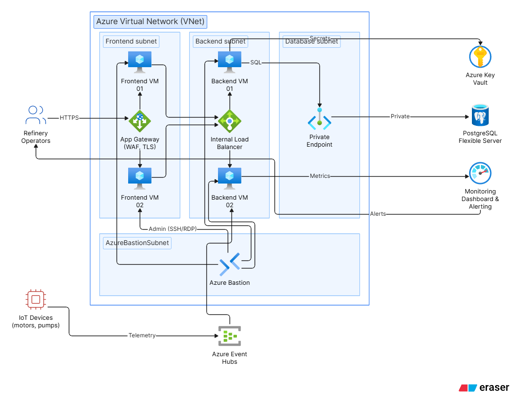
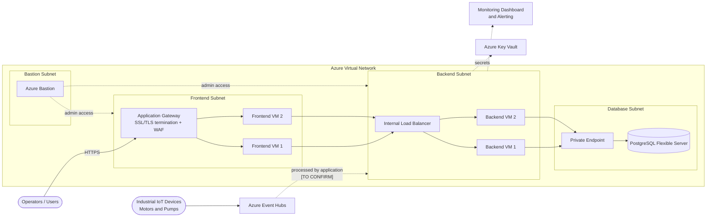
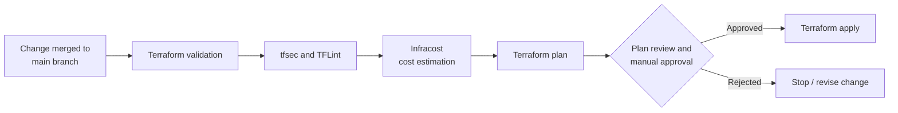
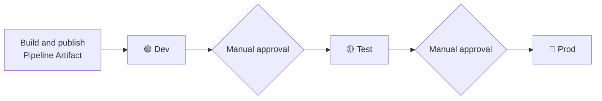
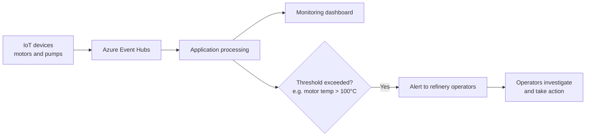

<div align="center">

# ☁️ Azure Landing Zone & DevSecOps
### Industrial IoT Monitoring and Alerting Platform for Petroleum Refineries

*A secure, three-tier Azure platform provisioned with Terraform and delivered through Azure DevOps pipelines, with built-in security, quality and cost controls.*


</div>

> [!NOTE]
> This repository documents the platform and delivery pipelines from a **DevSecOps** perspective. The application code was built by the wider development team. My contribution is described in [My DevSecOps Role and Responsibilities](#-14-my-devsecops-role-and-responsibilities).
>
> Items marked **`[TO CONFIRM]`** or **`<placeholder>`** are details that were not part of the source material and should be verified or filled in before publishing.

---

## ⚡ At a Glance

| | |
|---|---|
| 🏭 **Customer** | Australian company operating multiple petroleum refineries |
| 🎯 **Application** | Three-tier industrial IoT monitoring and alerting app |
| 📡 **Data source** | IoT devices on motors and pumps → Azure Event Hubs |
| 🏗️ **Infrastructure** | Azure Landing Zone, provisioned with modular Terraform |
| 🔄 **Delivery** | Azure DevOps pipelines: Dev → Test → Prod with manual approval gates |
| 🛡️ **Controls** | tfsec, TFLint, Infracost, SonarQube, WAF, private endpoints, Key Vault, Bastion |

---

## 📑 Table of Contents

1. [Project Overview](#-1-project-overview)
2. [Business Problem and Solution](#-2-business-problem-and-solution)
3. [Architecture Diagram](#-3-architecture-diagram)
4. [High-Level Architecture and Traffic Flow](#-4-high-level-architecture-and-traffic-flow)
5. [Azure Landing Zone and Network Design](#-5-azure-landing-zone-and-network-design)
6. [Security and Access Management](#-6-security-and-access-management)
7. [Terraform Repository Structure](#-7-terraform-repository-structure)
8. [Infrastructure CI/CD Pipeline](#-8-infrastructure-cicd-pipeline)
9. [Terraform Security, Validation and Cost Estimation](#-9-terraform-security-validation-and-cost-estimation)
10. [Application CI/CD Pipeline](#-10-application-cicd-pipeline)
11. [Dev, Test and Prod Promotion Strategy](#-11-dev-test-and-prod-promotion-strategy)
12. [Database Migration with Liquibase](#-12-database-migration-with-liquibase)
13. [Monitoring and Alerting](#-13-monitoring-and-alerting)
14. [My DevSecOps Role and Responsibilities](#-14-my-devsecops-role-and-responsibilities)
15. [Technology Stack](#-15-technology-stack)
16. [Setup and Deployment Guide](#-16-setup-and-deployment-guide)
17. [Validation and Troubleshooting](#-17-validation-and-troubleshooting)
18. [Cleanup and Cost Considerations](#-18-cleanup-and-cost-considerations)

---

## 🚀 1. Project Overview

This project delivers an Azure-hosted, three-tier **industrial IoT monitoring and alerting application** for an Australian customer that operates multiple petroleum refineries.

Industrial IoT devices attached to motors and pumps collect operational metrics and send them to **Azure Event Hubs**. The application processes the incoming data, presents it on monitoring dashboards, and raises alerts when readings breach configured thresholds.

The DevSecOps work covers two connected areas:

- 🧱 **Platform:** designing and provisioning the Azure Landing Zone as code with Terraform.
- 🔄 **Delivery:** building Azure DevOps pipelines that deploy both infrastructure and application across **Dev, Test and Prod**, with automated security, quality and cost checks and manual approval gates.

---

## 🎯 2. Business Problem and Solution

### The problem

Refinery motors and pumps are critical assets. Abnormal readings, such as rising temperature, can point to developing faults. Operators need timely visibility of equipment condition across multiple sites, and need to be notified quickly so they can investigate and act.

### The solution

| Need | How the platform addresses it |
|---|---|
| 📡 Collect equipment metrics | IoT devices send data to **Azure Event Hubs**, the ingestion point |
| 📊 See equipment condition | The application processes the data and shows it on **monitoring dashboards** |
| 🚨 Act on abnormal readings | **Alerts** notify operators when a metric crosses a configured threshold. Example: motor temperature above **100°C** |
| 🔒 Run it safely | Secured, segmented Azure network, delivered through repeatable, reviewed and approved pipelines |

---

## 🗺️ 3. Architecture Diagram

<div align="center">



</div>

> **`[TO CONFIRM]`** Update the image path above to match the location of the architecture diagram in the repository.

---

## 🔀 4. High-Level Architecture and Traffic Flow

The platform follows a classic three-tier pattern (presentation, application and data) with each tier placed in dedicated subnets of an Azure Virtual Network.

### 🌐 Request flow

1. **Users** (for example, refinery operators) reach the application through **Azure Application Gateway**, which terminates SSL/TLS and applies **Web Application Firewall (WAF)** inspection.
2. Application Gateway forwards permitted requests to the **two frontend VMs** running the frontend code.
3. The frontend tier calls the backend through an **Internal Load Balancer**, which distributes traffic across the **two backend VMs**.
4. The backend VMs connect to **Azure Database for PostgreSQL Flexible Server** through **private endpoints**, keeping database traffic on the private network.
5. Secrets are held in **Azure Key Vault**.

### 📡 Data ingestion and monitoring flow

1. **Industrial IoT devices** on motors and pumps publish metrics to **Azure Event Hubs**.
2. The application processes this data and surfaces it on the **monitoring dashboard**.
3. When a metric exceeds its configured threshold (for example, motor temperature above 100°C), the **alerting** component notifies operators.

### 🔑 Administrative access

Administrators reach the VMs through **Azure Bastion**, rather than exposing management ports to the internet.

### 🧩 Diagram

Dashed lines mark connections whose exact implementation should be confirmed against the architecture diagram.



> **`[TO CONFIRM]`** Which component consumes Event Hubs data, where the dashboard is hosted, how alerts are delivered, and which tiers read from Key Vault.

---

## 🧱 5. Azure Landing Zone and Network Design

The Landing Zone is provisioned entirely with Terraform. The network is split into dedicated subnets so each tier has a clear responsibility and limited exposure.

| Subnet | Purpose | Key components |
|---|---|---|
| 🟦 **Frontend** | Public-facing entry point and presentation tier | Application Gateway (SSL/TLS, WAF), two frontend VMs |
| 🟩 **Backend** | Application tier, not directly reachable from the internet | Internal Load Balancer, two backend VMs |
| 🟧 **Database** | Data tier | PostgreSQL Flexible Server access via private endpoints |
| 🟪 **Bastion** | Secure administrative access | Azure Bastion |

### 🚧 Network boundaries

- **Internet-facing traffic** enters only through Application Gateway, where TLS is terminated and the WAF inspects requests.
- **Backend traffic** passes through an **Internal Load Balancer**, so the backend tier is reached only from within the virtual network.
- **Database traffic** uses **private endpoints**, keeping PostgreSQL connectivity on the private network.
- **Administrative access** goes through Azure Bastion in its own subnet.

> **`[TO CONFIRM]`** Address spaces, subnet CIDR ranges, NSG rules, route tables, and whether Application Gateway shares the frontend subnet or has its own. These are left out deliberately to avoid stating unverified values.

---

## 🛡️ 6. Security and Access Management

| Control | Purpose |
|---|---|
| 🔥 **Application Gateway with WAF** | Terminates SSL/TLS and inspects inbound web traffic at the edge |
| 🧩 **Network segmentation** | Dedicated frontend, backend, database and Bastion subnets separate each tier |
| ⚖️ **Internal Load Balancer** | Keeps backend traffic internal to the virtual network |
| 🔐 **Private endpoints for PostgreSQL** | Keeps database connectivity on the private network |
| 🏰 **Azure Bastion** | Secure VM administration without exposing management ports directly to the internet |
| 🗝️ **Azure Key Vault** | Stores secrets so they are not embedded in code or pipeline definitions |
| 🔍 **tfsec and TFLint** | Scan Terraform for security misconfigurations and quality issues before deployment |
| 🧪 **SonarQube** | Code-quality checks for application code in CI pipelines |
| ✋ **Manual approval gates** | Human review before Terraform apply and before promotion between environments |

> **`[TO CONFIRM]`** RBAC role assignments, managed identities, Key Vault access model and the Azure DevOps service connection design.

---

## 📦 7. Terraform Repository Structure

The infrastructure code is **modular**: reusable **child modules** define each infrastructure component, while **environment-specific configuration** supplies the values for Dev, Test and Prod. This keeps environments consistent and reduces duplication.

A **trunk-based branching strategy** is used, with `main` as the trunk.

```text
<repository-root>/
├── modules/          # Reusable child modules (networking, compute, database, security, etc.)
│   └── <module-name>/
├── environments/     # Environment-specific configuration
│   ├── dev/
│   ├── test/
│   └── prod/
└── pipelines/        # Azure DevOps pipeline definitions
```

> **`[TO CONFIRM]`** The tree above is an **illustrative layout only**. Replace it with the real directory and module names.

---

## 🏗️ 8. Infrastructure CI/CD Pipeline

Infrastructure changes are delivered by **Azure DevOps pipelines that are separate from the application pipelines**. Changes go to the `main` branch and pass through validation, review and approval before anything is applied.



| Stage | What happens |
|---|---|
| ✅ **Validate** | Terraform configuration is validated |
| 🔍 **Scan** | tfsec and TFLint analyse the code |
| 💰 **Cost estimate** | Infracost estimates the cost impact |
| 📋 **Plan** | Terraform generates an execution plan |
| ✋ **Review and approve** | The plan is reviewed and explicitly approved |
| 🚀 **Apply** | Terraform applies the approved plan |

> **`[TO CONFIRM]`** Exact stage order, pipeline file names, remote state backend, and whether the same flow runs per environment.

---

## 🔐 9. Terraform Security, Validation and Cost Estimation

| Tool / Step | Role in the pipeline |
|---|---|
| ✅ **Terraform validation** | Checks the configuration is syntactically valid and internally consistent |
| 🛡️ **tfsec** | Static security analysis that flags potential misconfigurations |
| 🧹 **TFLint** | Linting for code quality, best practices and potential errors |
| 💰 **Infracost** | Shows the cost impact of proposed changes during review |
| 📋 **Plan review** | Engineers see exactly what will be created, changed or destroyed |
| ✋ **Manual approval** | Gate between plan and apply, so nothing is applied without sign-off |

> 💡 Running these checks before apply shifts security, quality and cost feedback to the earliest point in the delivery process.

---

## 🧑‍💻 10. Application CI/CD Pipeline

Application delivery uses **separate pipelines for frontend, backend and database**, so each component can be built, checked and released independently of the others and of infrastructure changes.

| Pipeline | Scope |
|---|---|
| 🖥️ **Frontend** | Build, quality check and deployment of frontend code to the frontend VMs |
| ⚙️ **Backend** | Build, quality check and deployment of backend code to the backend VMs |
| 🗄️ **Database** | Schema changes delivered with Liquibase ([section 12](#-12-database-migration-with-liquibase)) |

Common elements:

- 🧪 **SonarQube** code-quality checks
- 📦 **Azure Pipeline Artifacts** to publish build outputs, so the artifact that was tested is the one promoted
- 🚦 **Deployment across Dev, Test and Prod** with manual approval gates ([section 11](#-11-dev-test-and-prod-promotion-strategy))

### Infrastructure vs. application CI/CD

| | 🏗️ Infrastructure CI/CD | 🧑‍💻 Application CI/CD |
|---|---|---|
| **Delivers** | Azure resources (Landing Zone) via Terraform | Frontend, backend and database changes |
| **Checks** | Terraform validation, tfsec, TFLint, Infracost, plan review | SonarQube code-quality checks |
| **Output** | Applied infrastructure | Pipeline Artifacts deployed to environments |
| **Gate** | Manual approval before apply | Manual approval before promotion between environments |

> **`[TO CONFIRM]`** Build tooling, languages and frameworks, and the mechanism used to deploy artifacts to the VMs.

---

## 🚦 11. Dev, Test and Prod Promotion Strategy

Infrastructure and applications are promoted through three environments.



- 📦 A change is built once and the resulting **artifact** is promoted rather than rebuilt.
- ✋ **Manual approval gates** control movement between environments, so a release reaches Test and Prod only after explicit sign-off.
- ⚙️ Environment differences are handled through configuration, not separate code.

> **`[TO CONFIRM]`** Who approves at each gate, whether approval is also required before Dev, and any automated test criteria applied before approval.

---

## 🗄️ 12. Database Migration with Liquibase

Database schema changes are managed with **Liquibase** and delivered through a **dedicated database pipeline**. Changes are version-controlled, reviewable and applied in a consistent order across Dev, Test and Prod, alongside the manual approval gates used for the other pipelines.

The target is **Azure Database for PostgreSQL Flexible Server**, reached through private endpoints.

> **`[TO CONFIRM]`** Where the Liquibase job runs (which agent has network access to the private endpoint), changelog format and location, and the rollback approach.

---

## 📈 13. Monitoring and Alerting



1. IoT devices send metrics to **Azure Event Hubs**.
2. The application processes the incoming data.
3. Metrics appear on the **monitoring dashboard**.
4. When a metric exceeds a configured threshold, **alerts** notify refinery operators.
5. Operators investigate and take appropriate action.

> **`[TO CONFIRM]`** Technology behind the dashboard and alerting, notification channels, and how thresholds are configured. Platform-level monitoring (for example, VM health) is not in the source material and is not claimed here.

---

## 🧑‍🔧 14. My DevSecOps Role and Responsibilities

I worked as the **DevSecOps engineer** on this project. The application was built by the development team; my responsibilities were the Azure platform and the delivery pipelines around it.

- ☁️ Designed the **Azure Landing Zone architecture** and provisioned infrastructure with **Terraform**
- 📦 Structured the repository with **reusable child modules** and **environment-specific configuration**
- 🌳 Applied a **trunk-based branching strategy** using the `main` branch
- 🔄 Built **Azure DevOps pipelines** for Terraform and application CI/CD
- 🔍 Integrated **tfsec** and **TFLint** for security and quality checks
- 💰 Integrated **Terraform validation** and **Infracost** cost estimation
- ✋ Implemented **plan review, manual approval and apply** stages
- 🧩 Created **separate application pipelines** for frontend, backend and database changes
- 🧪 Added **SonarQube** checks and used **Azure Pipeline Artifacts**
- 🚦 Set up deployments across **Dev, Test and Prod** with **manual approval gates**
- 🗄️ Used **Liquibase** for database schema changes

---

## 🧰 15. Technology Stack

| Area | Technology |
|---|---|
| ☁️ **Cloud platform** | Microsoft Azure |
| 🏗️ **Infrastructure as Code** | Terraform |
| 🔄 **CI/CD** | Azure DevOps Pipelines, Azure Pipeline Artifacts |
| 🛡️ **IaC security and quality** | tfsec, TFLint, Terraform validation |
| 💰 **Cost estimation** | Infracost |
| 🧪 **Code quality** | SonarQube |
| 🗄️ **Database migrations** | Liquibase |
| 🌐 **Networking and edge** | Azure Virtual Network, Application Gateway (SSL/TLS, WAF), Internal Load Balancer |
| 💻 **Compute** | Azure Virtual Machines (frontend and backend tiers) |
| 🐘 **Data** | Azure Database for PostgreSQL Flexible Server (private endpoints) |
| 🔑 **Secrets and access** | Azure Key Vault, Azure Bastion |
| 📡 **Data ingestion** | Azure Event Hubs |
| 🌳 **Branching model** | Trunk-based development (`main`) |

---

## 🛠️ 16. Setup and Deployment Guide

Deployments are intended to run through the Azure DevOps pipelines rather than manually.

### ✅ Prerequisites

- Azure subscription with permissions to deploy the Landing Zone **`[TO CONFIRM]`**
- Azure DevOps organisation and project with pipeline permissions **`[TO CONFIRM]`**
- Azure DevOps service connection to Azure **`[TO CONFIRM]`**
- Tooling used by the pipelines: Terraform, tfsec, TFLint, Infracost, SonarQube, Liquibase **`[TO CONFIRM]`**
- Remote Terraform state location **`[TO CONFIRM]`**

### 📋 Deployment order

1. **Infrastructure:** merge the change to `main` and run the infrastructure pipeline. Review validation, scan, cost and plan outputs, then approve to apply.
2. **Database:** run the database pipeline to apply Liquibase schema changes.
3. **Backend and frontend:** run the backend and frontend pipelines to deploy application artifacts.
4. **Promote:** move the release through **Dev → Test → Prod**, approving at each gate.

### ⚙️ Configuration

```text
Repository URL:        <repository-url>
Pipeline definitions:  <path-to-pipeline-files>
Environment configs:   <path-to-environment-configs>
```

> Exact commands, variable names and values are intentionally left as placeholders. Add them from the repository once verified.

---

## 🔎 17. Validation and Troubleshooting

### ✔️ Validation checklist

- [ ] Infrastructure pipeline passed validation, tfsec, TFLint and Infracost stages
- [ ] Terraform plan reviewed and approved before apply
- [ ] Application reachable through Application Gateway over HTTPS
- [ ] Frontend VMs reach the backend through the Internal Load Balancer
- [ ] Backend VMs connect to PostgreSQL through the private endpoint
- [ ] Liquibase changes applied successfully in the target environment
- [ ] IoT data from Event Hubs appears on the monitoring dashboard
- [ ] A test threshold breach (for example, above 100°C) triggers an alert

### 🩺 Troubleshooting guide

| Symptom | Areas to check |
|---|---|
| Pipeline fails at a scan stage | Review tfsec/TFLint findings; fix or justify the flagged item |
| Cost estimate unexpectedly high | Review Infracost output and resources in the plan |
| Application not reachable | App Gateway listener and TLS config, WAF rules, backend health, network rules |
| Frontend cannot reach backend | Internal Load Balancer health, backend VM status, network rules between subnets |
| Backend cannot reach database | Private endpoint status, name resolution, network rules |
| Cannot administer a VM | Azure Bastion configuration and access permissions |
| No data on dashboard | Device-to-Event Hubs connectivity, application event processing |
| Alerts not received | Threshold configuration and notification channel setup |

> **`[TO CONFIRM]`** Add project-specific diagnostics, log locations and commands.

---

## 🧹 18. Cleanup and Cost Considerations

### 💰 Cost considerations

- **Infracost** estimates are produced in the infrastructure pipeline so cost impact is reviewed before approval.
- Resources in this architecture that typically carry ongoing cost: **VMs, Application Gateway, Azure Bastion, PostgreSQL Flexible Server** and **Event Hubs**. Check current Azure pricing and the Infracost output for real figures.
- Non-production environments can be reviewed for cost optimisation. **`[TO CONFIRM]`**

### 🗑️ Cleanup

1. Confirm the environment and its data can be removed.
2. Remove infrastructure through the Terraform pipeline or an approved destroy process. **`[TO CONFIRM]`**
3. Verify in the Azure portal that the resources are gone.

> [!WARNING]
> Destroying Prod resources should require explicit approval. **`[TO CONFIRM]`**

---

<div align="center">

## 👤 Author

**\<Aniket Kumar\>** · DevSecOps Engineer
\<LinkedIn\> · \<GitHub\> · \<Contact\>

⭐ *If you found this useful, consider giving the repo a star.*

</div>
