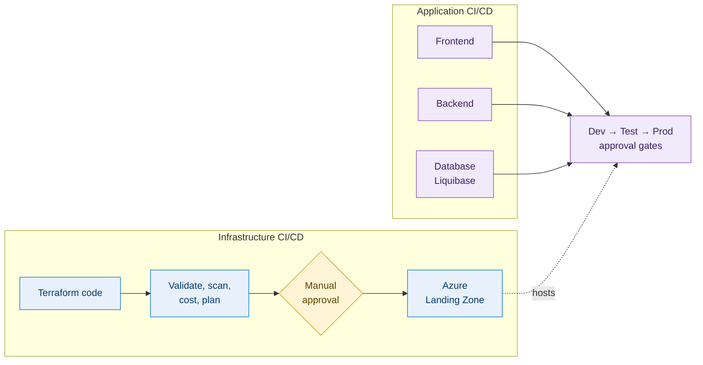
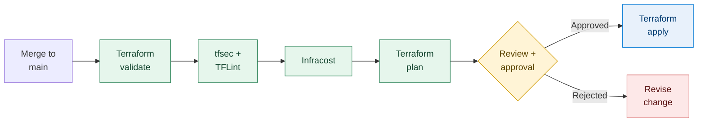
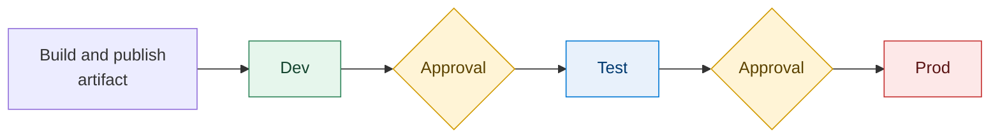
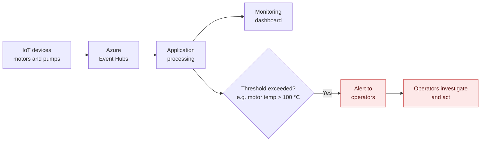

<div align="center">

# ☁️ Azure Landing Zone & DevSecOps

### A secure, automated Azure platform for Industrial IoT monitoring in petroleum refineries

**Infrastructure as code. Security shifted left. Every release scanned, costed, reviewed and approved.**

<br>


<br>

[**Architecture**](#architecture) · [**Security**](#security-model) · [**Pipelines**](#infrastructure-pipeline) · [**Design decisions**](#key-design-decisions) · [**My role**](#my-role) · [**Contact**](#contact)

</div>

> [!NOTE]
> The application code was written by the wider development team. This repository documents the **platform and the delivery pipelines**, the DevSecOps work I owned. See [My role](#my-role) for the details.

---

## At a glance

<div align="center">

| **3** | **3** | **4** | **4** | **2** |
|:---:|:---:|:---:|:---:|:---:|
| environments<br>Dev · Test · Prod | application pipelines<br>frontend · backend · database | network subnets<br>frontend · backend · database · Bastion | automated IaC checks<br>validate · tfsec · TFLint · Infracost | approval points<br>before apply · between environments |

</div>

| | |
|---|---|
| **The system** | A three-tier Azure application that collects IoT data from refinery motors and pumps, shows it on dashboards and alerts operators when a reading crosses a threshold |
| **The platform** | Azure Landing Zone provisioned with modular Terraform, split into dedicated subnets with a WAF at the edge and private database access |
| **The delivery** | Azure DevOps pipelines for infrastructure and for each application component, with security, quality and cost checks and manual approval gates |
| **My role** | DevSecOps Engineer: Landing Zone design, Terraform structure and every pipeline |

### 🔎 Reviewing this in 60 seconds?

| If you care about... | Go to |
|---|---|
| How the cloud is designed | [Architecture](#architecture) and [Network design](#network-design) |
| How it is secured | [Security model](#security-model) |
| How changes reach production safely | [Infrastructure pipeline](#infrastructure-pipeline) and [Promotion](#promotion-across-environments) |
| Why it was built this way | [Key design decisions](#key-design-decisions) |
| What I personally did | [My role](#my-role) |

---

## Table of contents

<details>
<summary><b>Click to expand</b></summary>

<br>

1. [The problem and the solution](#the-problem-and-the-solution)
2. [Architecture](#architecture)
3. [Network design](#network-design)
4. [Security model](#security-model)
5. [Terraform structure](#terraform-structure)
6. [Infrastructure pipeline](#infrastructure-pipeline)
7. [Application pipelines](#application-pipelines)
8. [Promotion across environments](#promotion-across-environments)
9. [Database migrations](#database-migrations)
10. [Monitoring and alerting](#monitoring-and-alerting)
11. [Key design decisions](#key-design-decisions)
12. [My role](#my-role)
13. [Technology stack](#technology-stack)
14. [Screenshots](#screenshots)
15. [Setup and deployment](#setup-and-deployment)
16. [Validation and troubleshooting](#validation-and-troubleshooting)
17. [Cleanup and cost](#cleanup-and-cost)
18. [Contact](#contact)

</details>

---

## The problem and the solution

Motors and pumps are critical equipment in a refinery. A temperature that keeps climbing, for example, can point to a fault that is still developing. Operators need to see the condition of equipment across several sites, and they need to be told quickly when something looks wrong.

| Need | How the platform handles it |
|---|---|
| Collect equipment metrics | IoT devices send data to **Azure Event Hubs** |
| See equipment condition | The application processes the data and shows it on monitoring dashboards |
| Act on abnormal readings | Operators are alerted when a metric crosses a threshold, such as motor temperature above **100 °C** |
| Run it safely | A segmented Azure network with layered controls, deployed through repeatable, reviewed and approved pipelines |

My part was everything underneath and around the application: the **Azure platform** and the **delivery pipelines**.



---

## Architecture

<div align="center">


*Application Gateway (TLS + WAF) → frontend VMs → Internal Load Balancer → backend VMs → PostgreSQL over private endpoints*

</div>

The platform is a classic three-tier design: presentation, application and data. Each tier sits in its own subnets of one Azure Virtual Network.


**Request flow**

1. Users, such as refinery operators, reach the application through **Azure Application Gateway**, which terminates TLS and inspects traffic with the **Web Application Firewall (WAF)**.
2. Application Gateway forwards allowed requests to the two frontend VMs.
3. The frontend calls the backend through an **Internal Load Balancer**, which spreads load across the two backend VMs.
4. The backend talks to **Azure Database for PostgreSQL Flexible Server** over private endpoints, so database traffic stays on the private network.
5. Secrets are kept in **Azure Key Vault**.

**Data ingestion:** IoT devices on motors and pumps publish metrics to **Azure Event Hubs**. The application processes them, updates the dashboard and checks alert thresholds.

**Administrative access:** Administrators connect to the VMs through **Azure Bastion**. No management ports are open to the internet.

---

## Network design

The whole Landing Zone is provisioned with Terraform. The network is split into dedicated subnets, so each tier has one job and limited exposure.

| Subnet | Purpose | Components |
|---|---|---|
| **Frontend** | Public entry point, presentation tier | Application Gateway (TLS, WAF), two frontend VMs |
| **Backend** | Application tier, not reachable from the internet | Internal Load Balancer, two backend VMs |
| **Database** | Data tier | PostgreSQL Flexible Server via private endpoints |
| **Bastion** | Administrative access | Azure Bastion |

| Boundary | Behaviour |
|---|---|
| 🌐 Internet → platform | Traffic enters only through Application Gateway, where TLS ends and the WAF inspects requests |
| ↔️ Frontend → backend | Goes through an Internal Load Balancer, so the backend is reachable only from inside the virtual network |
| 🗄️ Backend → database | Uses private endpoints, keeping PostgreSQL traffic on the private network |
| 🛠️ Admin → VMs | Goes through Azure Bastion in its own subnet |

---

## Security model

Security is layered: at the edge, inside the network, at the data tier, and in the delivery pipeline.

| Layer | Control | Purpose |
|---|---|---|
| **Edge** | Application Gateway with WAF | Ends TLS and inspects inbound web traffic |
| **Network** | Subnet segmentation | Separates frontend, backend, database and Bastion subnets |
| **Network** | Internal Load Balancer | Keeps backend traffic inside the virtual network |
| **Data** | Private endpoints for PostgreSQL | Keeps database connectivity private |
| **Access** | Azure Bastion | VM administration without public management ports |
| **Secrets** | Azure Key Vault | Keeps secrets out of code and pipeline definitions |
| **Pipeline** | tfsec and TFLint | Catch misconfigurations and quality problems before deployment |
| **Pipeline** | SonarQube | Code-quality checks on application code |
| **Process** | Manual approval gates | A person signs off before apply and before each promotion |

---

## Terraform structure

The Terraform code is modular. Reusable **child modules** define each component (networking, compute, database, security), and **environment-specific configuration** supplies the values for Dev, Test and Prod. Environments stay consistent and nothing is copy-pasted.

Branching is **trunk-based**, with `main` as the trunk.

```text
.
├── modules/          Reusable child modules
├── environments/     Environment-specific configuration
│   ├── dev/
│   ├── test/
│   └── prod/
└── pipelines/        Azure DevOps pipeline definitions
```

---

## Infrastructure pipeline

Infrastructure is delivered by Azure DevOps pipelines that are separate from the application pipelines. A change merged to `main` is validated, scanned, costed and planned, and it is applied **only after someone reviews the plan and approves it**.



| Stage | Tool | What it does |
|---|---|---|
| ✔️ Validate | `terraform validate` | Confirms the configuration is syntactically valid and consistent |
| 🔍 Scan | tfsec | Static security analysis that flags likely misconfigurations |
| 🧹 Lint | TFLint | Checks code quality, best practice and likely errors |
| 💰 Cost | Infracost | Shows the cost impact of the change while it is reviewed |
| 📋 Plan | `terraform plan` | Shows exactly what will be created, changed or destroyed |
| 👀 Approve | Manual gate | Nothing is applied without explicit sign-off |
| 🚀 Apply | `terraform apply` | Applies the approved plan |

> [!TIP]
> Every check runs **before** apply, so security, quality and cost problems surface when they are cheapest to fix.

---

## Application pipelines

Frontend, backend and database each have their own pipeline. Each can be built, checked and released without touching the others, and without waiting for an infrastructure change.

| Pipeline | Scope |
|---|---|
| **Frontend** | Build, quality check and deployment to the frontend VMs |
| **Backend** | Build, quality check and deployment to the backend VMs |
| **Database** | Schema changes with Liquibase |

Shared by all three: **SonarQube** quality checks, **Azure Pipeline Artifacts** for build output (so the artifact that was tested is the one that gets promoted), and deployment through Dev, Test and Prod with manual approval gates.

|  | Infrastructure CI/CD | Application CI/CD |
|---|---|---|
| **Delivers** | Azure resources (Landing Zone) via Terraform | Frontend, backend and database changes |
| **Checks** | Validate, tfsec, TFLint, Infracost, plan review | SonarQube |
| **Output** | Applied infrastructure | Pipeline Artifacts deployed to environments |
| **Gate** | Manual approval before apply | Manual approval before each promotion |

---

## Promotion across environments



- **Build once, promote the same artifact.** It is never rebuilt per environment.
- **Approval gates** control movement between environments, so a release reaches Test and Prod only after sign-off.
- **Configuration, not code,** is what differs between environments.

---

## Database migrations

Schema changes are handled by **Liquibase** and released through a dedicated database pipeline. Changes are version-controlled and reviewable, and they are applied in the same order in Dev, Test and Prod behind the same approval gates as the other pipelines.

The target is **Azure Database for PostgreSQL Flexible Server**, reached through private endpoints.

---

## Monitoring and alerting



---

## Key design decisions

| Decision | Why it matters |
|---|---|
| **Separate infrastructure and application pipelines** | An application release never waits on an infrastructure change, and the other way round |
| **Separate frontend, backend and database pipelines** | Each component ships independently, with a smaller blast radius per release |
| **Modular Terraform with per-environment configuration** | Dev, Test and Prod stay consistent, and there is no copy-pasted code |
| **Security and cost checks before apply** | Misconfigurations and surprise costs are caught while they are still cheap to fix |
| **Manual approval before apply and between environments** | A person signs off on every infrastructure change and every promotion |
| **Build once, promote the same artifact** | What was tested in Dev is exactly what reaches Prod |
| **Private endpoints for PostgreSQL** | Database traffic never leaves the private network |
| **Azure Bastion for administration** | No management ports are exposed to the internet |
| **Liquibase for schema changes** | Database changes are versioned, reviewable and applied in the same order everywhere |
| **Trunk-based branching on `main`** | One source of truth and a simple, predictable flow into the pipelines |

---

## My role

I was the **DevSecOps engineer** on this project. The development team built the application; I was responsible for the Azure platform and the delivery pipelines around it.

| Area | What I delivered |
|---|---|
| ☁️ **Landing Zone** | Designed the Azure Landing Zone and provisioned it with Terraform |
| 📦 **Terraform design** | Structured the repository into reusable child modules and per-environment configuration |
| 🌿 **Branching** | Applied a trunk-based strategy on `main` |
| 🔧 **Pipelines** | Built Azure DevOps pipelines for Terraform and application CI/CD |
| 🔐 **IaC security and quality** | Integrated tfsec and TFLint |
| 💰 **Validation and cost** | Integrated Terraform validation and Infracost |
| ✅ **Controlled apply** | Set up the plan review, manual approval and apply stages |
| 🧩 **Application pipelines** | Created separate pipelines for frontend, backend and database |
| 📊 **Code quality** | Added SonarQube checks and used Azure Pipeline Artifacts |
| 🚦 **Promotion** | Set up deployments across Dev, Test and Prod with manual approval gates |
| 🗄️ **Schema changes** | Used Liquibase for database migrations |

**Skills demonstrated:** `Azure Landing Zone design` · `Terraform modules` · `Azure DevOps YAML pipelines` · `Shift-left security` · `Network segmentation` · `Private endpoints` · `Secrets management` · `FinOps with Infracost` · `Release governance` · `Database migrations as code`

---

## Technology stack

| Area | Technology |
|---|---|
| ☁️ Cloud platform | Microsoft Azure |
| 🏗️ Infrastructure as Code | Terraform |
| 🔧 CI/CD | Azure DevOps Pipelines, Azure Pipeline Artifacts |
| 🔐 IaC security and quality | tfsec, TFLint, Terraform validate |
| 💰 Cost estimation | Infracost |
| 📊 Code quality | SonarQube |
| 🗄️ Database migrations | Liquibase |
| 🌐 Networking and edge | Virtual Network, Application Gateway (TLS, WAF), Internal Load Balancer |
| 💻 Compute | Azure Virtual Machines (frontend and backend tiers) |
| 🛢️ Data | Azure Database for PostgreSQL Flexible Server (private endpoints) |
| 🔑 Secrets and access | Azure Key Vault, Azure Bastion |
| 📡 Data ingestion | Azure Event Hubs |
| 🌿 Branching model | Trunk-based development (`main`) |

---

## Screenshots

<!--
Add your own sanitized screenshots here (remove secrets, subscription IDs and internal names first).
Save images in docs/images/ and uncomment the rows below.

| Infrastructure pipeline run | Approval gate |
|:---:|:---:|
|  |  |

| Infracost output | SonarQube result |
|:---:|:---:|
|  |  |
-->

*Screenshots coming soon.*

---

## Setup and deployment

Deployments are meant to run through the Azure DevOps pipelines, not by hand.

**Prerequisites**

- An Azure subscription with permission to deploy the Landing Zone
- An Azure DevOps organisation and project with pipeline permissions
- A service connection from Azure DevOps to Azure
- A remote Terraform state backend
- The tools the pipelines use: Terraform, tfsec, TFLint, Infracost, SonarQube, Liquibase

**Deployment order**

1. **Infrastructure:** merge to `main` and run the infrastructure pipeline. Check the validation, scan, cost and plan output, then approve to apply.
2. **Database:** run the database pipeline to apply the Liquibase changes.
3. **Backend and frontend:** run their pipelines to deploy the application artifacts.
4. **Promote:** move the release through Dev, Test and Prod, approving at each gate.

---

## Validation and troubleshooting

<details>
<summary><b>✅ Post-release checklist</b></summary>

<br>

- [ ] The infrastructure pipeline passed validate, tfsec, TFLint and Infracost
- [ ] The Terraform plan was reviewed and approved before apply
- [ ] The application is reachable over HTTPS through Application Gateway
- [ ] Frontend VMs reach the backend through the Internal Load Balancer
- [ ] Backend VMs connect to PostgreSQL through the private endpoint
- [ ] Liquibase changes were applied in the target environment
- [ ] IoT data from Event Hubs appears on the dashboard
- [ ] A test threshold breach (for example, above 100 °C) triggers an alert

</details>

<details>
<summary><b>🩺 Troubleshooting guide</b></summary>

<br>

| Symptom | Where to look |
|---|---|
| Pipeline fails at a scan stage | tfsec and TFLint findings; fix the issue, or record why it is accepted |
| Cost estimate higher than expected | Infracost output and the resources in the plan |
| Application not reachable | Application Gateway listener and TLS config, WAF rules, backend health, network rules |
| Frontend cannot reach backend | Internal Load Balancer health, backend VM status, rules between subnets |
| Backend cannot reach database | Private endpoint status, name resolution, network rules |
| Cannot administer a VM | Bastion configuration and access permissions |
| No data on the dashboard | Device connectivity to Event Hubs, application event processing |
| Alerts not received | Threshold configuration and notification channel setup |

</details>

---

## Cleanup and cost

**Cost:** Infracost runs in the infrastructure pipeline, so the cost of a change is visible **before** it is approved. The resources that carry ongoing cost are the VMs, Application Gateway, Azure Bastion, PostgreSQL Flexible Server and Event Hubs. For real numbers, check current Azure pricing and the Infracost output.

**Cleanup**

1. Confirm that the environment and its data can be removed.
2. Remove the infrastructure through the Terraform pipeline or an approved destroy process.
3. Check in the Azure portal that the resources are gone.

> [!WARNING]
> Destroying Prod should always need explicit approval.

---

## Contact

<div align="center">

### 👋 Let's connect

**Aniket Kumar** · DevSecOps Engineer

[](https://linkedin.com/in/aniket484)
[](https://github.com/aniket-devop)

⭐ If this project helped you, consider giving the repo a star.

</div>
